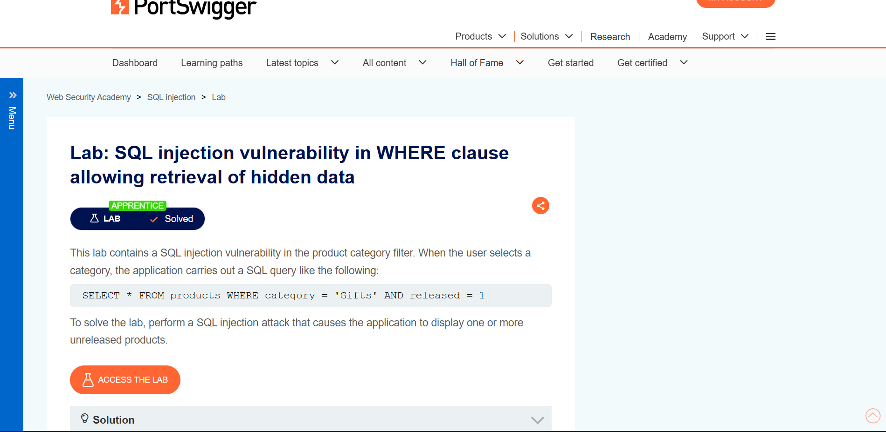
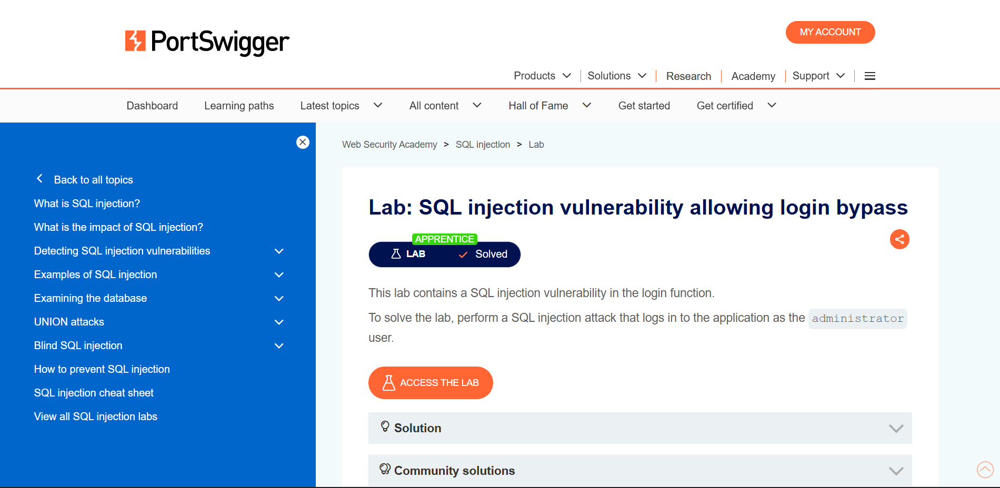

# SQL Injection: 2 Apprentice Labs

| Lab | Payload idea | Why it works |
|---|---|---|
| Hidden data in WHERE clause | `' OR 1=1--` in the category parameter | Makes the condition always true and comments out `AND released=1` |
| Login bypass | `administrator'--` as username | The comment removes the password check |

## Proof of completion
| Lab | Screenshot |
|---|---|
| WHERE clause, hidden data |  |
| Login bypass |  |

The vulnerable query in the first lab:
```sql
SELECT * FROM products WHERE category = 'Gifts' AND released = 1
```

## Fix
Use parameterized queries / prepared statements, never string concatenation.

<!-- Add: the vulnerable query as a code block + a screenshot per lab -->
